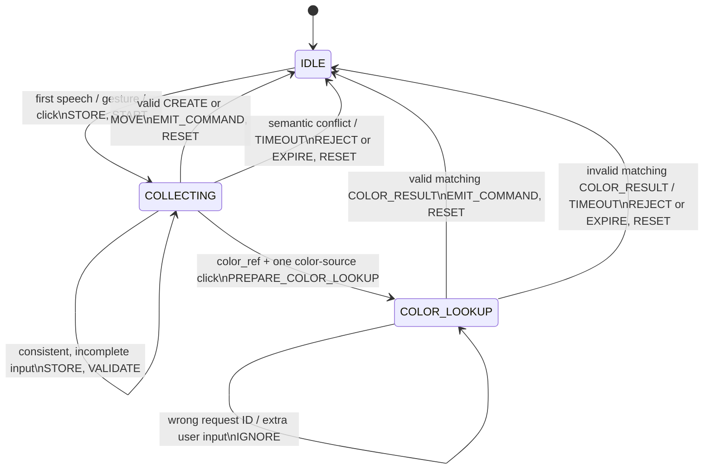

# Multimodal Dialogue Controller — FSM Design

**Status:** Python FSM implemented and unit-tested; palette color lookup and movement integration pending.  
**Reference:** `docs/interface_contract.md` (v0.1) and UPSSITECH `lab3-5_fusion.md`.  
**Owner:** Developer B (fusion and dialogue).  
**Updated:** 2026-10-13.

## 1. Purpose and scope

The controller combines speech, gesture, and pointing events to create and move shapes. It supports flexible input order, a bounded temporal window, and a rule forbidding monomodal commands. As required by the assignment, this document describes **actions/events first**, followed by the **state machine** and its **state/event matrix**.

**Implementation status:** Python creation, movement-command generation, conflicts, timeouts, deictic object designation, and the `COLOR_LOOKUP` state with `on_color_result()` are implemented. One speech+click creation *without color* has been verified end to end with Ivy and the Processing palette. Actual palette execution of `Fusion Move`, `Fusion GetColor`, `Palette ColorAt`, and colored creation is **not yet verified/implemented** in the current integration.

## 2. Actions

### 2.1 User operations

| Operation | Required inputs | Options and constraints | Current implementation |
| --- | --- | --- | --- |
| `create` | Action + exactly one consistent shape; at least two modalities | Spoken named color; spoken `position_ref` requires a click; default position is allowed when no position is requested | Generates `PaletteCommand(action="create", ...)` |
| `move` | Action + shape **or** spoken `target_ref=True`; two clicks | First click = source, second = destination; spoken color can filter; `shape="any"` means target unspecified | Generates `PaletteCommand(action="move", ...)`; Processing must resolve unique object |
| `create` with `color_ref=True` | Spoken color reference + action/shape + one color-source click | Not combined with `position_ref` or `target_ref` in this version; color must come from a palette query | Prepares `ColorLookupRequest`, awaits `on_color_result()`, then returns a colored create command |

Named colors come from speech only. `position_ref=True` must be satisfied by actual pointing; a default coordinate cannot replace it. The current controller does not know Processing object identities, so detecting empty/ambiguous object selections is **the Palette's responsibility**.

### 2.2 Controller actions

| Action | Meaning / code |
| --- | --- |
| `STORE`, `START` | Add `InputEvent` to `FusionBuffer`; set `started_at` on first event |
| `EXPIRE` | Expire dialogue when `now - started_at > window_s`, including through `on_tick()` |
| `VALIDATE` | Test action, shape, spoken color, click count, references, and at least two modalities |
| `REJECT` | Cancel on conflicting action/shape/colors; store `last_rejection_reason` |
| `PREPARE_COLOR_LOOKUP` | `_start_color_lookup()` prepares request ID and clicked coordinates; does **not** send an Ivy message |
| `HANDLE_COLOR_RESULT` | `on_color_result(id, color, now)` validates response and pending context |
| `EMIT_COMMAND` | Return at most one `PaletteCommand` |
| `RESET` | Clear buffer, state, start time, and pending query after success/timeout/rejection |

Interactive clarification is **not implemented**; conflicting semantic inputs cause immediate cancellation rather than a `CLARIFICATION` state.

## 3. Events

### 3.1 Input events defined in `events.py`

| Event kind | Modality | Payload |
| --- | --- | --- |
| `speech.command` | Speech | `action`, `shape`, `color`, `position_ref`, `color_ref`, `target_ref` (partial slots allowed) |
| `gesture.recognized` | Gesture | `shape` and/or `action` |
| `pointing.click` | Pointing | `x`, `y` in palette pixels |

Raw Ivy messages are parsed by Developer A's adapter, which produces normalized `InputEvent` values with monotonic timestamps. The controller is called from a serialized event consumer.

### 3.2 Internal events / methods

| Event | Implementation |
| --- | --- |
| `TIMEOUT` | `on_tick(now)` or an event received after the fixed dialogue window |
| Semantic conflict | `_conflict_reason(events)`; reset and rejection reason |
| `COLOR_RESULT` | **Separate** `on_color_result()` method; it is **not** an `InputEvent.kind` |
| Invalid / ambiguous palette color | Matching `on_color_result()` call with `none`, `ambiguous`, or unsupported color: reject and reset |
| `CANCEL` (explicit user command) | Not yet implemented; `reset()` is available internally |
| Ambiguous overlapping objects | Not resolved in Python; requires Processing hit-testing |

## 4. Fusion context and invariants

| Data | Current location / meaning |
| --- | --- |
| Events | `FusionBuffer` |
| `state` | `IDLE`, `COLLECTING`, or `COLOR_LOOKUP` |
| `started_at` | First-event time of the current dialogue |
| `default_position` | Fallback for creations without a spoken positional reference |
| `pending_color_request` | `ColorLookupRequest(request_id, x, y)` |
| `_color_request_seq` | Monotonic counter within one controller process; survives `reset()` |
| `last_rejection_reason` | Diagnostic reason after a rejected dialogue |

Action, shape, color, and click roles are **derived from buffered events**, not kept as separate persistent slots. The previous design's `last_event_at`, `modalities_seen`, and separate `source_position`/`destination_position` fields are *not* implemented.

**Invariants:**

1. A completed command combines at least **two distinct modalities**.
2. The dialogue deadline is fixed at **4 seconds by default** from `started_at`; subsequent events do not extend it. `FusionBuffer` is rolling, but the dialogue is not.
3. Incomplete and consistent inputs remain in `COLLECTING`; conflicting action, shape, or spoken colors cause a reset.
4. A requested position needs a click. A move needs exactly two clicks, interpreted as source then destination.
5. During `COLOR_LOOKUP`, new user input is ignored until completion or timeout.
6. Wrong color request IDs are ignored without consuming the pending request. Matching invalid colors and expired replies cannot create shapes.
7. The buffer and pending query are cleared after command execution, rejection, or timeout. A query ID counter persists within an instance, **not across process restarts**.
8. A combined `color_ref=True` + `position_ref=True` request is unresolved: clicks cannot yet be assigned unambiguously to color source versus destination.
9. Producing a `PaletteCommand(move, ...)` does not prove the Palette moved a real object; hit-testing and ambiguity checks remain integration work.

## 5. Implemented finite-state machine

| State | Meaning |
| --- | --- |
| `IDLE` | No pending dialogue; buffer and color request empty |
| `COLLECTING` | Collect and validate partial multimodal information |
| `COLOR_LOOKUP` | Wait for an asynchronous response matching `pending_color_request` |

`EXECUTING` in the initial proposal is an **instantaneous output-and-reset operation**, not a stored enum state. `CLARIFICATION` is a **future design extension**, not implemented. There is no actual transition through those two states.

## 6. State/event matrix (implemented)

Legend: `S` = store, `V` = validate, `Q` = prepare query, `E` = emit command, `R` = reset, `—` = ignore.

| Current state | New speech / gesture / click | Complete valid context | Matching color result | Wrong / unsolicited color result | Contradiction / invalid matching color | `TIMEOUT` |
| --- | --- | --- | --- | --- | --- | --- |
| `IDLE` | `S` → `COLLECTING` | N/A | `—` | `—` | N/A | Stay `IDLE` |
| `COLLECTING` | `S,V` → `COLLECTING` or `Q` → `COLOR_LOOKUP` | `E,R` → `IDLE` | N/A | `—` | `R` → `IDLE` on semantic conflict | `R` → `IDLE` |
| `COLOR_LOOKUP` | `—` while within deadline | Blocked | Valid: `E,R` → `IDLE`; invalid: `R` → `IDLE` | `—`, stay `COLOR_LOOKUP` | `R` → `IDLE` for invalid matching color | `R` → `IDLE` |

A color reply is checked for **timeout before request ID**. Receiving a late user event during `COLOR_LOOKUP` also triggers timeout and may begin a fresh dialogue. The adapter must route replies to the controller in its single consumer thread; the Ivy request/reply transport is still pending.

## 7. Chronogram-style acceptance examples

### A. Create with speech then click — end-to-end verified

| Time | Event | Result |
| --- | --- | --- |
| 10.0 s | Speech `create circle here` | `IDLE` → `COLLECTING` |
| 11.0 s | Click `(200, 180)` | Return `PaletteCommand(create, circle, 200, 180)` → `IDLE` |

An actual Ivy test emitted `Fusion Create=cercle X=229 Y=278`, and the circle appeared in Processing.

### B. Click before speech — Python unit-tested

| Time | Event | Result |
| --- | --- | --- |
| 10.0 s | Click `(200, 180)` | `IDLE` → `COLLECTING` |
| 11.0 s | Speech `create circle here` | Return matching creation command → `IDLE` |

### C. Speech plus gesture — Python unit-tested

| Time | Event | Result |
| --- | --- | --- |
| 10.0 s | Speech `create` | `IDLE` → `COLLECTING` |
| 11.0 s | Gesture `diamond` | Create diamond at documented default position → `IDLE` |

### D. Movement — Python unit-tested; Palette execution pending

| Time | Event | Result |
| --- | --- | --- |
| 10.0 s | Speech `move rectangle` | `IDLE` → `COLLECTING` |
| 10.8 s | Click source `(100, 150)` | Still `COLLECTING` |
| 11.7 s | Click destination `(300, 250)` | Return `PaletteCommand(move, rectangle, 300, 250, from_x=100, from_y=150)` |

Spoken `target_ref=True` without a shape yields `shape="any"`; the Palette must find one unambiguous target.

### E. Fixed timeout — Python unit-tested

| Time | Event | Result |
| --- | --- | --- |
| 10.0 s | Speech `create circle here` | `COLLECTING` |
| 13.0 s | Compatible gesture | Still `COLLECTING` |
| 14.5 s | Pointing click | Old dialogue has expired; no creation using stale speech |

### F. Referenced color — Python unit-tested; Ivy lookup pending

| Time | Event | Result |
| --- | --- | --- |
| 10.0 s | Speech `create circle color_ref=true` | `COLLECTING` |
| 11.0 s | Click `(220, 160)` on color source | Prepare request ID 1, enter `COLOR_LOOKUP` |
| 11.5 s | `on_color_result(1, "red", 11.5)` | Generate colored circle creation at default position; reset |

Wrong IDs, stale replies and ambiguous/invalid color replies must not create an object.

## 8. Remaining implementation and validation

1. **Developer A:** send `Fusion GetColor X=... Y=... RequestId=...`; listen for `Palette ColorAt RequestId=... Color=...`; convert French colors and route matching replies to `on_color_result()` in the single consumer.
2. **Developer A:** implement palette hit-testing for color queries, reject `none` and `ambiguous`, and accept `Color=...` for colored creation.
3. **Developer A + B:** implement real `Fusion Move` execution and test selection/overlapping objects with optional spoken color filter.
4. **Developer B:** test duplicate replies, stale IDs after a new query, timeout boundaries, unrelated input while waiting, and reset behavior.
5. **Shared:** design a grammar or clarification protocol for combined `position_ref` and `color_ref`, update class diagrams and chronograms, and capture screenshots for the report.

**Validation recorded:** 50 Python tests passed before the additional robustness tests. The speech-plus-click creation without color was observed end to end. This is **not** proof of functional colored creation or movement in Processing.
