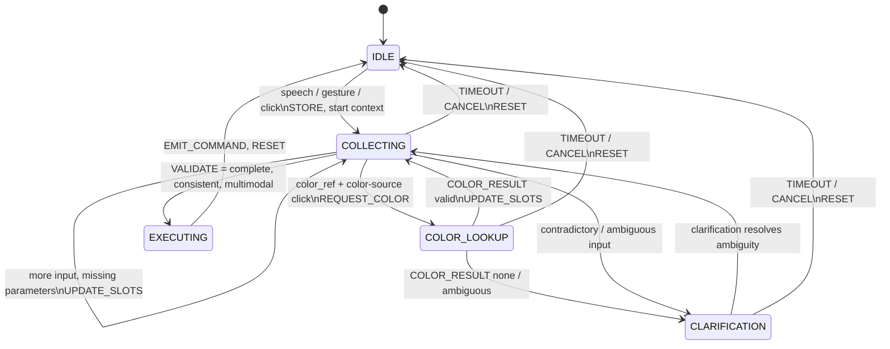

# Multimodal Dialogue Controller — FSM Design

**Status:** Design proposal, to be reviewed with Developer A before implementing advanced interactions.  
**Reference:** `docs/interface_contract.md` (v0.1) and the UPSSITECH `lab3-5_fusion.md` assignment.  
**Owner:** Developer B (fusion and dialogue).  

## 1. Purpose and scope

The dialogue controller combines speech, gesture and mouse pointing to create or move graphical shapes. It must allow flexible arrival order, keep partial information during a bounded temporal window and never execute a user-facing monomodal operation.

This document first identifies **actions and events**, then defines the **state machine** and finally the **state/event matrix**, following the order requested by the assignment.

**Implementation boundary:** The current `DialogueController` MVP supports multimodal creation only. Movement, referenced colors and clarification are not implemented. The FSM here is a proposed target design, not a description of already working features.

## 2. Actions

### 2.1 User operations (required)

| Operation | Required semantic data | Optional data | Completion condition |
| --- | --- | --- | --- |
| `create` | Action and shape (circle, rectangle, triangle, diamond) | Explicit spoken color, spoken color reference, optional designated position | All explicitly requested references resolved; at least two distinct user modalities |
| `move` | Action, shape, selected source object, target position | Spoken color filter to disambiguate | Exactly one matching source object, destination known; at least two distinct user modalities |

A spoken **“here”** explicitly requests a real click; it cannot be satisfied by a default position. A spoken **“this color”** requires a click on a source object, followed by a color lookup. When no position is explicitly designated for `create`, a documented default may be used only when the interaction is otherwise multimodal. Explicit color information must be spoken.

### 2.2 Controller actions

| Internal action | Meaning |
| --- | --- |
| `STORE` | Add the received event to the temporal context |
| `EXPIRE` | Remove expired events and cancel stale dialogues |
| `UPDATE_SLOTS` | Accumulate recognized action, shape, color, reference flags and clicks |
| `VALIDATE` | Check completeness, two modalities, domain constraints and contradictions |
| `REQUEST_COLOR` | Request the palette color at a designated location (future protocol extension) |
| `EMIT_COMMAND` | Produce one `PaletteCommand` for the output adapter |
| `REQUEST_CLARIFICATION` | Wait for a disambiguating input, or cancel if unsupported |
| `RESET` | Clear context after execution, cancellation or timeout |

## 3. Events

### 3.1 Inputs already defined in `InputEvent`

| `kind` | Modality | Relevant payload | Meaning |
| --- | --- | --- | --- |
| `speech.command` | `speech` | `action`, `shape`, `color`, `position_ref`, `color_ref`, `target_ref` | Spoken semantics; may be incomplete |
| `gesture.recognized` | `gesture` | `shape` or `action` | Recognized shape or operation |
| `pointing.click` | `pointing` | `x`, `y` | A click in Processing canvas coordinates |

The adapter normalizes provider-specific messages; the FSM never parses raw `sra5` or OneDollarIvy messages. All received timestamps are measured on the same monotonic clock.

### 3.2 Internal / future events

| Event | Trigger | Status |
| --- | --- | --- |
| `TIMEOUT` | Pending interaction exceeds temporal window | Internal event triggered by `on_tick(now)` / expiry check |
| `CANCEL` | Explicit cancellation or controller fault | Proposed; no existing `InputEvent` kind |
| `COLOR_RESULT` | Palette returns a color or reports no matching object | Proposed palette query response; **not** currently covered by `InputEvent` or `EventKind` |
| `AMBIGUITY` | Multiple compatible shapes / objects or conflicting values | Internal validation outcome, not an Ivy message |

Adding `COLOR_RESULT` to the public API requires coordination with Developer A: agree on `Palette ColorAt` handling and how its result reaches the controller. Do not pretend the existing `InputEvent` signature already supports it.

## 4. Fusion context and invariants

The dialogue context (built from `FusionBuffer` and controller-specific slots) must store at least:

| Data | Purpose |
| --- | --- |
| `started_at`, `last_event_at` | Define the dialogue temporal window |
| `modalities_seen` | Enforce at least two distinct user modalities |
| `action`, `shape`, `color` | Collected semantic constraints |
| `position_ref`, `color_ref`, `target_ref` | Detect references that must be resolved by pointing |
| `pointing_events` | Preserve click order and their locations |
| `source_position`, `destination_position`, `color_source_position` | Resolved click roles; keep them distinct |
| `pending_color_request` | Track an outstanding palette query / request ID |
| `ambiguity_reason` | Explain why execution is blocked |

**Design invariant:** the temporal window is measured against the first event of the pending dialogue, not extended indefinitely by every new event. Proposed `FUSION_WINDOW_S=4.0`, configurable after chronogram-based evaluation. The current rolling `FusionBuffer` alone does not implement all transactional-dialogue semantics.

**Pointer-role rule to validate together:** For `move`, two sequential clicks refer to the source object and destination, respectively (even if speech or gesture is received after either click). For a command containing both `color_ref` and `position_ref`, two clicks can be ambiguous unless the design can associate each designation with a specific segment of speech. The controller should request clarification or reject rather than silently assigning roles. A robust implementation may need separate reference-tagging events or more detailed grammar semantics.

## 5. Proposed finite-state machine

### State semantics

| State | Invariant |
| --- | --- |
| `IDLE` | No pending operation; buffer empty |
| `COLLECTING` | One dialogue context exists; new modalities and slots are accumulated |
| `COLOR_LOOKUP` | An asynchronous color query is outstanding; never emit a command until resolved |
| `CLARIFICATION` | Input is ambiguous/contradictory; no arbitrary command is issued |
| `EXECUTING` | Transient state: emit at most one complete command, then reset immediately |

The initial Python MVP only has `IDLE` and `COLLECTING`; the remaining states are **design targets**, not implemented behavior. A simplified implementation may cancel on ambiguity rather than support interactive clarification, as long as it does not execute an arbitrary command and the limitation is documented.

## 6. State/event matrix

Legend: `S` = store/update slots; `V` = validate operation; `Q` = query palette color; `E` = emit; `R` = reset; `C` = record ambiguity/clarification; `—` = no state change (event may be logged).

| Current state | Speech / gesture / pointing | Complete valid multimodal context | `COLOR_RESULT` | Contradiction / ambiguity | `TIMEOUT` / `CANCEL` |
| --- | --- | --- | --- | --- | --- |
| `IDLE` | `S` → `COLLECTING` | Not applicable | `—` | `—` | `R` → `IDLE` |
| `COLLECTING` | `S`, `V` → `COLLECTING`, or `Q` → `COLOR_LOOKUP` if necessary | `E` → `EXECUTING` → `IDLE` | Ignore stale result | `C` → `CLARIFICATION` | `R` → `IDLE` |
| `COLOR_LOOKUP` | Preserve or defer inputs; no execution | Blocked pending color result | Valid → `COLLECTING` then `V`; invalid → `CLARIFICATION` | `C` → `CLARIFICATION` | `R` → `IDLE` |
| `CLARIFICATION` | Update slots if disambiguating; `V` → `COLLECTING` | Execute only after successful revalidation | Handle only matched pending request | Remain `CLARIFICATION` or cancel | `R` → `IDLE` |
| `EXECUTING` | No new dialogue mutation until reset | `E`, `R` → `IDLE` | `—` | `—` | `R` → `IDLE` |

**Priority of checks:** expiration/cancellation → contradictions and reference ambiguities → pending asynchronous color lookup → completeness → minimum two modalities → command emission. The matrix is a design outline; exact handling of events received during color queries or clarification must be locked down before coding those features.

## 7. Chronogram-style acceptance examples

### A. Create with speech then click

| Time | Event | State | Outcome |
| --- | --- | --- | --- |
| 10.0 s | Speech `create circle here` | `IDLE` → `COLLECTING` | Need pointing |
| 11.0 s | Click `(200, 180)` | `COLLECTING` → `EXECUTING` → `IDLE` | `PaletteCommand(create, circle, 200, 180)` |

### B. Create with click then speech (order flexibility)

| Time | Event | State | Outcome |
| --- | --- | --- | --- |
| 10.0 s | Click `(200, 180)` | `IDLE` → `COLLECTING` | Await semantics |
| 11.0 s | Speech `create circle here` | `COLLECTING` → `EXECUTING` → `IDLE` | Same command as example A |

### C. Create with speech and gesture

| Time | Event | State | Outcome |
| --- | --- | --- | --- |
| 10.0 s | Speech `create` | `IDLE` → `COLLECTING` | Need shape and second modality |
| 11.0 s | Gesture `diamond` | `COLLECTING` → `EXECUTING` → `IDLE` | Create diamond at agreed default position |

### D. Move a selected shape (future implementation)

| Time | Event | State | Outcome |
| --- | --- | --- | --- |
| 10.0 s | Speech `move this rectangle here` | `IDLE` → `COLLECTING` | Need source and destination |
| 10.8 s | Click source `(100, 150)` | `COLLECTING` | Source candidate known |
| 11.7 s | Click destination `(300, 250)` | `COLLECTING` → `EXECUTING` → `IDLE` only if source unambiguous | Emit move command |

### E. Expired dialogue

| Time | Event | State | Outcome |
| --- | --- | --- | --- |
| 10.0 s | Speech `create circle here` | `IDLE` → `COLLECTING` | Waiting for click |
| 15.0 s | Click `(200, 180)` | Old dialogue expires | No creation from stale speech |

## 8. Next implementation steps

1. Validate design decisions about mouse-click roles, default creation position and ambiguous references with Developer A.
2. Add controller-level dialogue timeout anchored to `started_at`, without breaking the existing four `FusionBuffer` tests.
3. Implement FSM transitions for `create` and tests for speech-before-click, click-before-speech, gesture+speech, contradiction and expiration.
4. Extend to `move` only after agreeing on object selection and target detection with the palette developer.
5. Add `color_ref` only after specifying the palette query/reply API and its async integration.
6. Preserve passing tests (`python -m pytest -v`) and add transition-specific regression tests.
